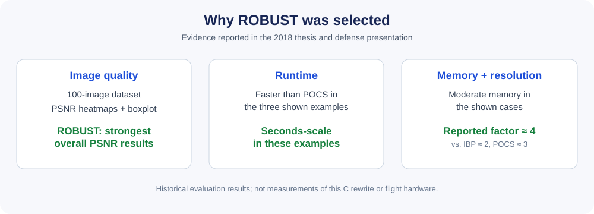
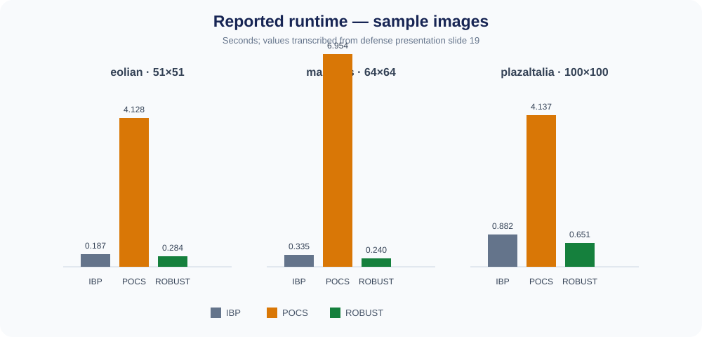

# ROBUST selection: results from the 2018 thesis

This page summarizes selected results from Rodolfo Jara's thesis, *Implementación y evaluación de algoritmos de súper-resolución para imágenes tomadas con nano satélites* (Universidad de Chile, 2018), and its defense presentation. It documents the motivation for the ROBUST port; it is **not** a validation report for the current C rewrite.

## Why ROBUST was selected

The thesis compared three multi-frame super-resolution algorithms:

- **IBP** — Iterative Back Projection
- **POCS** — Projection Onto Convex Sets
- **ROBUST** — the robust method attributed in the presentation to Oded Hanson, based on the Farsiu et al. approach

The evaluation considered visual resolution gain, execution time, memory use, and PSNR across a dataset of 100 terrestrial-surface images. The presentation's PSNR heatmaps and boxplot show ROBUST with the strongest overall PSNR distribution of the three methods. The thesis describes its PSNR range and average as higher than those of IBP and POCS.

The selection was therefore a trade-off, not a claim that ROBUST was fastest in every test: the thesis reports that IBP could process images quickly but used substantially more memory in the examples; POCS used relatively little memory but took much longer; ROBUST combined a higher reported resolution factor with moderate memory use and shorter execution times than POCS in the shown examples.

## Example runtime and memory measurements

The defense presentation (slide 19) reports the following measurements for three sample images. Values are copied from the presentation; these are **examples**, not averages over the 100-image dataset.

| Sample image | Input size | Algorithm | Runtime (s) | Memory (bytes) | Reported resolution factor |
|---|---:|---|---:|---:|---:|
| eolian | 51 × 51 | IBP | 0.187 ± 0.001 | 7,502,056 | 2 |
| eolian | 51 × 51 | POCS | 4.128 ± 0.033 | 566,752 | 3 |
| eolian | 51 × 51 | ROBUST | 0.284 ± 0.002 | 995,856 | 4 |
| malvinas | 64 × 64 | IBP | 0.335 ± 0.009 | 11,810,152 | 2 |
| malvinas | 64 × 64 | POCS | 6.954 ± 0.035 | 877,712 | 3 |
| malvinas | 64 × 64 | ROBUST | 0.240 ± 0.012 | 874,816 | 4 |
| plazaltalia | 100 × 100 | IBP | 0.882 ± 0.017 | 28,817,376 | 2 |
| plazaltalia | 100 × 100 | POCS | 4.137 ± 0.052 | 1,145,744 | 3 |
| plazaltalia | 100 × 100 | ROBUST | 0.651 ± 0.036 | 2,417,216 | 4 |

## PSNR evaluation

The thesis built a 10 × 10 heatmap from a dataset of 100 images of Earth's surface. PSNR was computed between the reconstructed result and the corresponding reference image. In the presentation's heatmaps and boxplot, ROBUST has the highest overall PSNR range and median-looking central value; the thesis also states that its average PSNR was higher than IBP and POCS.

The original presentation figures are qualitative evidence here; exact aggregate PSNR statistics are not transcribed because the slide does not provide a numerical summary table. A high PSNR is an image-quality indicator under this comparison, not by itself proof of mission suitability.

## Relevance to a nanosatellite

The thesis considered limited onboard computing, memory and downlink bandwidth. Its suggested-use-case table associates approximate resolution factors of 2, 3 and 4 with IBP, POCS and ROBUST, respectively, and presents ROBUST as a candidate for onboard processing with a seconds-scale response in the studied scenarios.

These findings motivate a C port. They do not show that the current C code has been deployed on SUCHAI hardware, meets a flight timing budget, or reproduces MATLAB outputs exactly.

## Current C-port status

The current implementation is an initial, modular C rewrite of the MATLAB ROBUST sources. It compiles with strict GCC warnings and has smoke tests for selected primitives. Full numerical parity against MATLAB, realistic image-level regression tests, and target-hardware profiling remain out of scope for this first public version.

## Source notes

- Rodolfo Jara Pinochet, *Implementación y evaluación de algoritmos de súper-resolución para imágenes tomadas con nano satélites*, Universidad de Chile, 2018.
- Defense presentation, slides 14, 19, and 21–26: ROBUST algorithm outline; sample runtime/memory measurements; 100-image dataset; PSNR heatmaps and comparison; suggested-use-case table.

The presentation and thesis describe the original evaluation. The C implementation in this repository is a separate, unfinished engineering port.
